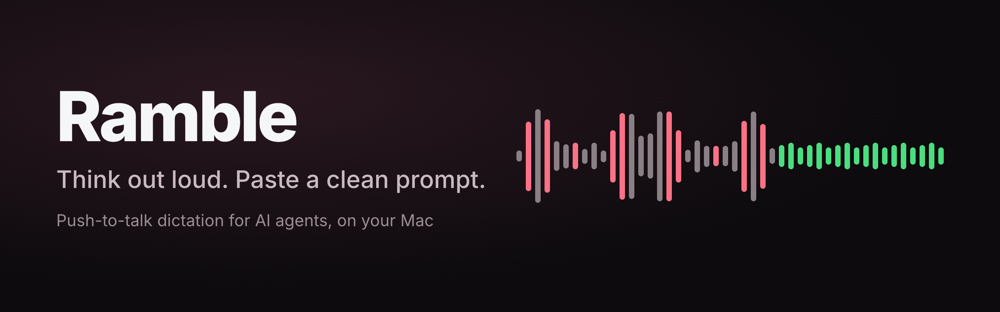
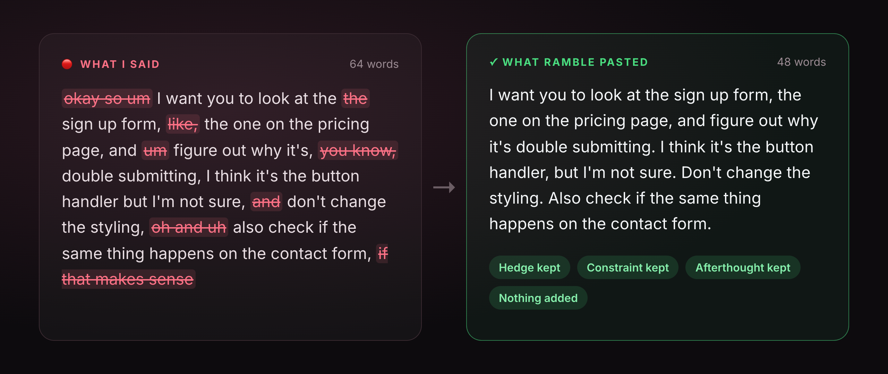
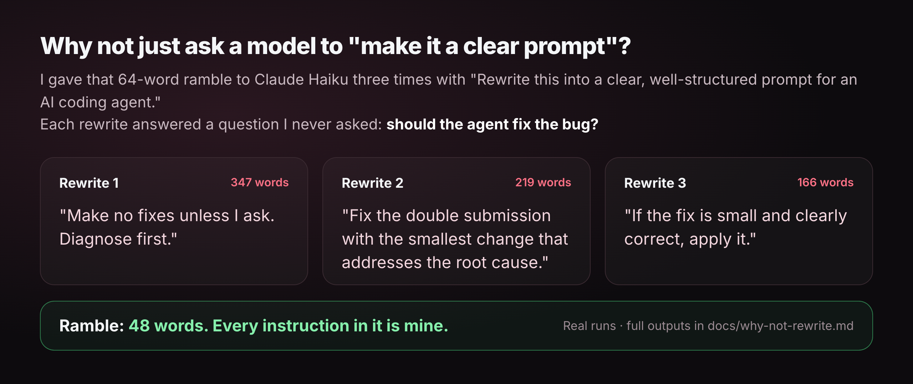
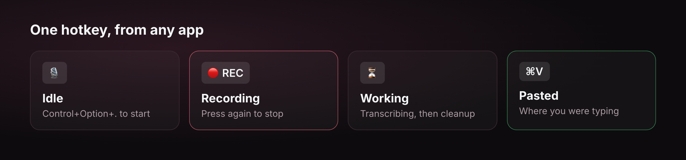
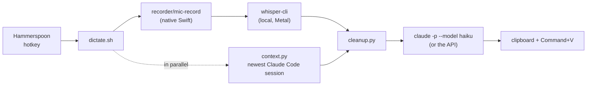

<p align="center">
  
</p>

<p align="center">
  <a href="https://github.com/lukegeel101/ramble/actions/workflows/ci.yml"></a>
  
  
  
  
</p>

# Ramble

**Talk to AI agents the way you naturally think out loud.**
Ramble turns your ums, likes, false starts and brainstorming into a clean, faithful prompt the agent can act on, without adding or dropping anything you said.

<p align="center">
  
</p>

<details>
<summary>The same example as text</summary>

What I said, as the transcriber heard it:

> okay so um I want you to look at the the sign up form, like, the one on the pricing page, and um figure out why it's, you know, double submitting, I think it's the button handler but I'm not sure, and don't change the styling, oh and uh also check if the same thing happens on the contact form, if that makes sense

What Ramble pasted:

> I want you to look at the sign up form, the one on the pricing page, and figure out why it's double submitting. I think it's the button handler, but I'm not sure. Don't change the styling. Also check if the same thing happens on the contact form.

</details>

## About

Ramble is push-to-talk dictation for macOS, built for prompting AI agents.
Press a hotkey in any app, talk, press it again, and a few seconds later the cleaned-up text is pasted where you were typing.
[whisper.cpp](https://github.com/ggml-org/whisper.cpp) transcribes on your Mac, so the audio never leaves it, and Claude Haiku takes out the noise and nothing else.
It is a handful of shell and Python scripts, a small Swift recorder and a Hammerspoon hotkey, and it is MIT licensed.

## Why I built it

I do most of my work by talking to AI agents, and I think out loud when I do it.
I start a sentence, change my mind, circle back, and say "like" and "you know" a lot while I figure out what I actually want.
Speaking is faster than typing, and it gets more of what's in my head into the prompt, the hedges and the "oh, and also" that I'd never bother to type.

The problem is what comes out of the transcriber.
Pasting raw speech into an agent wastes tokens and muddies the ask.
The obvious fix, having a model "turn it into a clear prompt", turned out to be worse.

<p align="center">
  
</p>

I asked for one diagnosis and got back three different jobs.
One rewrite told the agent not to touch anything, one told it to fix the bug, and one said to fix it if the fix looked small, none of which I said.
A rewrite that changes what you meant is worse than no rewrite at all, because the agent will faithfully do the wrong thing.
The full outputs are in [docs/why-not-rewrite.md](docs/why-not-rewrite.md).

So Ramble only takes out the noise.
My words, my order, my hedges and every detail stay.

## Why it's useful

- **Faster than typing, without the mess.** Talk at full speed, paste something an agent can act on.
- **Faithful.** The cleanup is told never to summarize, reorder, add or drop anything; `lab.py` has a stronger model check that it didn't.
- **Private.** Transcription is local; only the transcript text goes to the cleanup model.
- **Cheap.** About $0.002 a dictation on Haiku, in Claude plan usage.
- **Context-aware.** In a terminal or the Claude app it reads the last few messages of your Claude Code session, so "the second option" or "that PR" come out precise.
- **Gets your names right.** A glossary of people, projects and tools fixes the words whisper always mishears.
- **Never loses what you said.** If cleanup fails or is slow, the raw transcript is pasted instead, and one hotkey copies the last raw transcript at any time.

<p align="center">
  
</p>

## How I use it

Ramble is how I write almost every prompt now.
I press Control+Option+., talk through what I want the way I'd explain it to a colleague, and let it paste into Claude Code, the Claude app, or wherever my cursor is.
For quick replies it's a sentence or two; for a new task it's often a minute of thinking out loud, and the agent gets all of it, minus the ums.

The nerdiest bug I hit along the way: ffmpeg was quietly dropping about one in seven audio buffers on my Mac.
Over 159 dictations the audio came out a median 4 seconds shorter than what I said, so the transcriber never heard some of my words.
The small native Swift recorder in `recorder/` fixed it: a 20-second recording now keeps 19.9 seconds.
The details are in [docs/gotchas.md](docs/gotchas.md).

## What it does

- **Push to talk anywhere.** Control+Option+. starts recording and stops it again, from any app; a menu bar item shows idle, recording or working.
- **Transcribes on your Mac.** [whisper.cpp](https://github.com/ggml-org/whisper.cpp) runs locally with Metal; the audio never leaves the computer.
- **Light-touch cleanup.** Claude Haiku removes fillers and false starts, fixes misheard words and adds punctuation, and is told never to summarize, reorder, add or drop anything. Only the transcript text is sent.
- **Pastes for you.** The result goes on the clipboard and is pasted with Command+V if the app you stopped in is still in front.
- **Knows the conversation.** When you dictate into a terminal or the Claude app, the last few messages of your newest Claude Code session go along as reference, so "the second option" or "that PR" come out precise.
- **Learns your names.** A glossary of people, projects and tools biases whisper toward the right spellings and lets the cleanup fix what is left.
- **Never loses what you said.** If cleanup fails or is slow, the transcript is pasted as heard; Control+Option+Shift+. copies the last raw transcript at any time.
- **A test bench.** `lab.py` runs a transcript through every variant of the pipeline and has a stronger model check whether the cleanup changed your meaning.

## Quick start

You need macOS, [Homebrew](https://brew.sh), the Xcode Command Line Tools, and [Claude Code](https://code.claude.com) installed and signed in (`claude` on your PATH), or an Anthropic API key (see Direct API below).

```sh
brew install whisper-cpp ffmpeg
brew install --cask hammerspoon
git clone https://github.com/lukegeel101/ramble.git
cd ramble
./install.sh
```

`install.sh` checks the prerequisites, copies the scripts to `~/.ramble`, builds the native recorder, downloads the whisper model (about 466 MB), and adds one `require("ramble")` line to your Hammerspoon `init.lua`.
It backs `init.lua` up first and never replaces it; running it again updates the scripts and keeps your settings.
Set `RAMBLE_HOME` to install somewhere else.

Then reload the Hammerspoon config, press Control+Option+., and allow microphone access when macOS asks.
For auto-paste, allow Hammerspoon under System Settings, Privacy & Security, Accessibility.

## Settings

Settings live in `config` in the install folder (start from `config.example`); `dictate.sh` reads it on every press, so changes apply at once.
The ones that matter most:

| Setting | Default | What it does |
|---|---|---|
| `RAMBLE_PROMPT` | `cleanup` | Cleanup instructions: `cleanup` (light touch) or `structured` (reorders and numbers your requests) |
| `RAMBLE_CLEANUP` | `1` | `0` pastes the transcript exactly as heard |
| `RAMBLE_CLEANUP_MODEL` | `haiku` | Model for `claude -p` |
| `RAMBLE_CLEANUP_SECONDS` | `30` | Give up on cleanup after this long and paste the transcript as heard |
| `RAMBLE_CLEANUP_HEDGE` | `8` | Start a parallel second attempt when the first has not answered after this long |
| `RAMBLE_CLEANUP_MIN_WORDS` | `6` | Shorter dictations only get a local filler strip, no model call |
| `RAMBLE_MODEL` | `models/ggml-small.en.bin` | The whisper.cpp model; `ggml-base.en.bin` is faster and less accurate |
| `RAMBLE_RECORDER` | `native` | `native` (the Swift recorder) or `ffmpeg` |
| `RAMBLE_CONTEXT` | `1` | `0` cleans up without the conversation's last messages |
| `RAMBLE_GLOSSARY`, `RAMBLE_HINT` | `1` | `0` leaves the glossary out of cleanup, or the name hint out of whisper |
| `RAMBLE_API_KEY_FILE` | `~/.config/ramble/anthropic-api-key` | Call the API directly when this file exists |

`install.sh` itself reads `RAMBLE_HOME` (default `~/.ramble`), `RAMBLE_MODEL_NAME` (default `ggml-small.en.bin`) and `HAMMERSPOON_DIR` (default `~/.hammerspoon`).
To change the hotkeys, edit the top of `~/.hammerspoon/ramble.lua`; to turn off auto-paste, create a file named `no-autopaste` in the install folder.

### Glossary

`glossary.md` in the install folder lists the names you say, how to spell them, and how whisper mishears them; `glossary.example.md` shows the format.
Its "Transcriber hint" line goes to `whisper-cli --prompt`, which biases transcription toward those spellings, so keep it under about 200 tokens.
The whole file goes to the cleanup model, which uses it for spelling only and is told never to add a role or detail from it.

### Conversation context

When you stop recording in a terminal, VS Code, Cursor or the Claude app, `context.py` reads the newest interactive Claude Code session written in the last two hours and sends up to 6 messages and 8,000 characters (about 2,000 tokens) ahead of the transcript.
Headless `claude -p` runs are skipped, so background jobs never count as the conversation.
It runs while whisper transcribes, so it adds no wait, and the prompt forbids copying anything from it that you did not say.
`RAMBLE_CONTEXT_APPS` adds other apps by bundle ID.

### Direct API

By default cleanup runs `claude -p` with no tools, no MCP servers, no hooks and no saved session, which uses your Claude plan and usually takes a few seconds, most of it Claude Code starting up.
If `~/.config/ramble/anthropic-api-key` exists (one line, the key, `chmod 600`), cleanup calls the Anthropic API directly instead: about 1 second, billed to that key.

## Cost and speed

On my MacBook Air, whisper's `small.en` model transcribes a typical sentence in 1 to 2 seconds after the first run of the day.
The cleanup call through Claude Code carries about 8,300 tokens of fixed overhead, and the glossary and a full conversation context add a few thousand more; on Haiku that comes to about $0.002 a dictation in plan usage.

## Test bench

`lab.py` finds which step changed what you said:

```sh
~/.ramble/lab.py compare transcript.txt --ref "what you actually said"
~/.ramble/lab.py audio ~/.ramble/recordings/last.wav
~/.ramble/lab.py last
```

`compare` runs a transcript through the live cleanup (twice, because the model is not deterministic), the structured instructions, no glossary, no context, and the local filler strip, with a word error rate against `--ref`.
`audio` also transcribes with and without the name hint.
`last` and `check` have Sonnet compare a transcript with its rewrite using `prompts/meaning.md` and list anything added, dropped or changed, rated major or minor.
Rewrites with the same words as the transcript pass without a model call.

## How it works



- `dictate.sh` is the whole pipeline (`toggle`, `start`, `stop`, `status`, `raw`); a lock makes a press during transcription answer "busy" instead of starting over.
- `recorder/mic-record.swift` records the default input to a 16 kHz mono WAV through AVAudioRecorder; ffmpeg is the fallback.
- `cleanup.py` builds the system prompt from `prompts/cleanup.md` and the glossary, and races hedged attempts so one stalled call does not hold up the paste.
- `state/` holds the last raw transcript, the last cleanup and the last context sent; `recordings/last.wav` is the last recording; `dictate.log` is the log.

## Develop

```sh
python3 -m unittest discover -s tests -t .
```

The tests run `dictate.sh`, `cleanup.py`, `context.py`, `lab.py` and `install.sh` against stand-ins in `tests/bin` (a fake `claude` that prints stream-json, a fake `whisper-cli`, a fake recorder and a `pbcopy` that writes to a file), so they need no microphone, no model and no Claude account, and never touch your clipboard.
Known pitfalls are in [docs/gotchas.md](docs/gotchas.md).

## Uninstall

Remove the `require("ramble")` line from `~/.hammerspoon/init.lua`, delete `~/.hammerspoon/ramble.lua` and `~/.ramble`, and reload Hammerspoon.

## Ideas

- A local page that shows recent dictations side by side with the cleanup's changes marked, and lets you rate them.
- Starting Claude Code while you are still speaking, for machines where its start-up is slow.
- Linux support (the focused app is hard to read under Wayland, and there is no Hammerspoon).

## License

MIT
